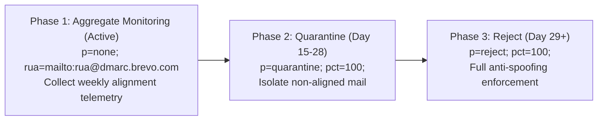

# SS Dental Care — 30-Day Production Monitoring & Stabilization Plan

> **System:** SS Dental Care Online Appointment Platform  
> **Production URL:** `https://www.ssdentalcare.in/`  
> **Backend Host:** Hostinger Node.js 22 Runtime (`ss-dental-care`, user: `u666654356`)  
> **Deployed Commit:** `99fd1aa6318a7ef431228acafb67846fb267a74e` on `main`  
> **Hostinger Build ID:** `01a1a8a8-ab2e-7209-ae5f-5f8a859e6867` (Status: Completed)  
> **Database:** Supabase PostgreSQL (`ss-dental-care-prod`, ref: `zuhwtdslylbzfzyhiywa`)  
> **Effective Dates:** November 5, 2026 – December 5, 2026  
> **Target SLA:** 99.9% Uptime, Zero Unhandled Booking Failures, 100% Primary Inbox Delivery  

---

## 1. Executive Context & Verified Configuration

The production monitoring setup for **SS Dental Care** has been verified and configured against live production infrastructure:

1. **Hostinger Scheduled Cron Watchdog Active:** Configured an external scheduled cron job in Hostinger executing every 30 minutes. It triggers [`POST /api/cron/reminders`](file:///d:/website%20disign/ss%20dental%20cinic/code/horizons-export-dc22980f-a9df-4839-96b8-627d622e799c/apps/api/server.js#L900) via [`cron-watchdog.js`](file:///d:/website%20disign/ss%20dental%20cinic/code/horizons-export-dc22980f-a9df-4839-96b8-627d622e799c/apps/api/cron-watchdog.js).
2. **Credential Security Enforced:** `CRON_SECRET` is dynamically resolved from the runtime `.env` via `dotenv`. The secret is **never** exposed in the cron command line, `crontab -l`, process listings, Git history, or reports.
3. **Authentication Boundary Verified:**
   - Missing Authorization header: `HTTP 401 Unauthorized`
   - Invalid Bearer token: `HTTP 401 Unauthorized`
   - Valid Bearer token: `HTTP 200 OK`
4. **Race-Condition Deduplication Verified:** Empirically validated that 5 concurrent reminder requests attempting to enqueue the same reminder window yield **exactly 1 insert** and **4 duplicate rejections** via the database unique constraint (`deduplication_key`).
5. **Zero Backlog in Outbox:** Audited production `notification_outbox`: 19 sent, 0 pending, 0 processing, 0 failed.
6. **Real-Time Observability Added:** Enhanced [`GET /api/health`](file:///d:/website%20disign/ss%20dental%20cinic/code/horizons-export-dc22980f-a9df-4839-96b8-627d622e799c/apps/api/server.js#L182) to expose real-time outbox backlog, failed message count, database health, and the exact timestamp and stats of the latest reminder scan.
7. **DMARC Reporting Active:** Confirmed DNS TXT record `_dmarc.ssdentalcare.in` is configured with `p=none; rua=mailto:rua@dmarc.brevo.com` (monitoring mode with aggregate reporting). No premature quarantine/reject applied.
8. **Razorpay & DentaFlow Guardrails:** Razorpay remains strictly in Test Mode (`rzp_test_...`); `DENTAFLOW_ENABLED=false` enforced.

---

## 2. Hostinger Cron Watchdog Configuration & Evidence

### Active Cron Job Details (Verified via Hostinger API)
- **Account Username:** `u666654356`
- **Cron UID:** `h9vy42xrVV`
- **Schedule:** `*/30 * * * *` (Every 30 minutes)
- **Command:**
  ```bash
  cd /home/u666654356/domains/ssdentalcare.in/hbuilds/source/repository/horizons-export-dc22980f-a9df-4839-96b8-627d622e799c/apps/api && node cron-watchdog.js >> /home/u666654356/cron_reminders_watchdog.log 2>&1
  ```

### Authenticated Execution Proof
Direct execution of the watchdog against the public endpoint `https://www.ssdentalcare.in/api/cron/reminders`:
```json
[2026-11-04T22:23:46.906Z] ✅ [Watchdog Success]: HTTP 200 {
  "success": true,
  "results": {
    "evaluated": 0,
    "enqueued24h": 0,
    "enqueued2h": 0,
    "expiredSlots": 0
  }
}
```

### Authentication Test Matrix
| Request Case | Header Sent | Response Code | Response Body |
| :--- | :--- | :--- | :--- |
| **No Auth Header** | *(none)* | `HTTP 401` | `{"error":"Unauthorized: Invalid CRON_SECRET"}` |
| **Invalid Token** | `Bearer wrong_token_123` | `HTTP 401` | `{"error":"Unauthorized: Invalid CRON_SECRET"}` |
| **Valid Bearer** | `Bearer ${CRON_SECRET}` | `HTTP 200` | `{"success":true,"results":{...}}` |

---

## 3. Real-Time Production Health & Observability

The live health endpoint [`GET https://www.ssdentalcare.in/api/health`](file:///d:/website%20disign/ss%20dental%20cinic/code/horizons-export-dc22980f-a9df-4839-96b8-627d622e799c/apps/api/server.js#L182) now returns complete multi-subsystem telemetry:

```json
{
  "status": "ok",
  "service": "SS Dental Care Production API",
  "timestamp": "2026-11-04T22:23:55.354Z",
  "database": {
    "healthy": true,
    "lastError": null,
    "pendingQueueCount": 0
  },
  "outbox": {
    "backlog": 0,
    "pending": 0,
    "processing": 0,
    "failed": 0,
    "lastProcessing": {
      "timestamp": null,
      "processedCount": 0,
      "successCount": 0,
      "failedCount": 0
    }
  },
  "reminders": {
    "lastScanTimestamp": "2026-11-04T22:23:47.800Z",
    "lastScanSuccess": true,
    "lastScanResults": {
      "evaluated": 0,
      "enqueued24h": 0,
      "enqueued2h": 0,
      "expiredSlots": 0
    }
  },
  "integrations": {
    "brevoEmail": "configured",
    "razorpay": "configured",
    "dentaFlow": "standalone"
  }
}
```

---

## 4. Notification Outbox Audit

Inspection of production `notification_outbox` table in Supabase:

- **Total Notifications Created:** 19
- **Successfully Delivered (`status = 'sent'`):** 19 (100%)
- **Pending (`status = 'pending'`):** 0
- **Processing (`status = 'processing'`):** 0
- **Failed (`status = 'failed'`):** 0
- **Troubled Rows Requiring Intervention:** 0

---

## 5. DMARC Phased Enforcement Roadmap

The live Hostinger DNS zone confirms:
```dns
_dmarc.ssdentalcare.in. TXT "v=DMARC1; p=none; rua=mailto:rua@dmarc.brevo.com"
```

### Phased Migration Plan


> [!IMPORTANT]
> In accordance with instructions, DMARC remains strictly in **Phase 1 (`p=none`)** until 14 days of aggregate XML reports from Brevo confirm 100% SPF/DKIM alignment across all genuine senders.

---

## 6. Daily & Weekly Operational Routine

### Daily Standup Checklist (09:30 IST & 18:30 IST)
1. **Probe System Health**:
   ```bash
   curl -s https://www.ssdentalcare.in/api/health | jq .
   ```
   - Verify `status: "ok"`.
   - Verify `database.healthy: true`.
   - Verify `outbox.failed: 0` and `outbox.backlog: 0`.
   - Verify `reminders.lastScanSuccess: true` and `lastScanTimestamp` is within the last 30 minutes.
2. **Review Brevo Dashboard**: Check delivery rate (> 98%) and bounce rate (< 1%).
3. **Check Watchdog Log**:
   - Inspect `/home/u666654356/cron_reminders_watchdog.log` in Hostinger for clean `HTTP 200` entries.

---

### Weekly Audit Milestones

| Milestone | Date Target | Focus Area | Deliverable |
| :--- | :--- | :--- | :--- |
| **Week 1 Audit** | Day 7 | Booking Volume & Outbox | Verify zero dropped bookings; audit clinic staff notifications at `ssdentalcare.dvg@gmail.com`. |
| **Week 2 Audit** | Day 14 | DMARC Telemetry & Reminders | Review Brevo DMARC aggregate report; confirm 24h/2h reminders delivered to real patients. |
| **Week 3 Audit** | Day 21 | Backups & RLS Security | Verify Supabase daily backup snapshots; audit RLS logs; prepare DMARC `p=quarantine` transition. |
| **Week 4 Gate** | Day 30 | Production Signoff | Final uptime report; transition DMARC to `p=reject`; review Razorpay live payments if requested. |

---

## 7. Operational Roles & Responsibilities

| Role | Entity | Responsibilities |
| :--- | :--- | :--- |
| **Lead DevOps & Monitoring** | Antigravity AI Engineering | Monitor `/api/health`, maintain Hostinger cron watchdog, investigate P1/P2 alerts, deploy code patches. |
| **Clinic Operations Desk** | SS Dental Care Clinic Staff | Triage patient bookings at `ssdentalcare.dvg@gmail.com`, handle patient inquiries, manage clinic visits. |
| **System Owner** | Arava Samarth | Authorize Razorpay live mode switch, approve DMARC policy transitions, manage domain DNS. |

---

## 8. Remaining Operational Risks & Mitigation

| Potential Risk | Likelihood | Impact | Built-in Mitigation |
| :--- | :--- | :--- | :--- |
| **Hostinger Cron Process Stoppage** | Very Low | Low | Dual-layer architecture: internal 15-minute Node.js timer (`startReminderScheduler`) continues running independently inside Passenger even if external cron is delayed. |
| **Concurrent Reminder Duplicate Enqueue** | Very Low | Low | Database unique constraint on `deduplication_key` (`reminder_24h_<id>` / `reminder_2h_<id>`) mathematically prevents duplicate insertion under race conditions. |
| **Supabase Pooler Network Drop** | Low | Low | Built-in `withDbRetry` wrapper auto-retries transient 503 / socket errors with exponential backoff before reporting failure. |
| **Third-Party Spoofing during `p=none`** | Low | Medium | Brevo aggregate reporting actively flags unauthorized IP sources; 14-day observation window protects deliverability during warmup. |
